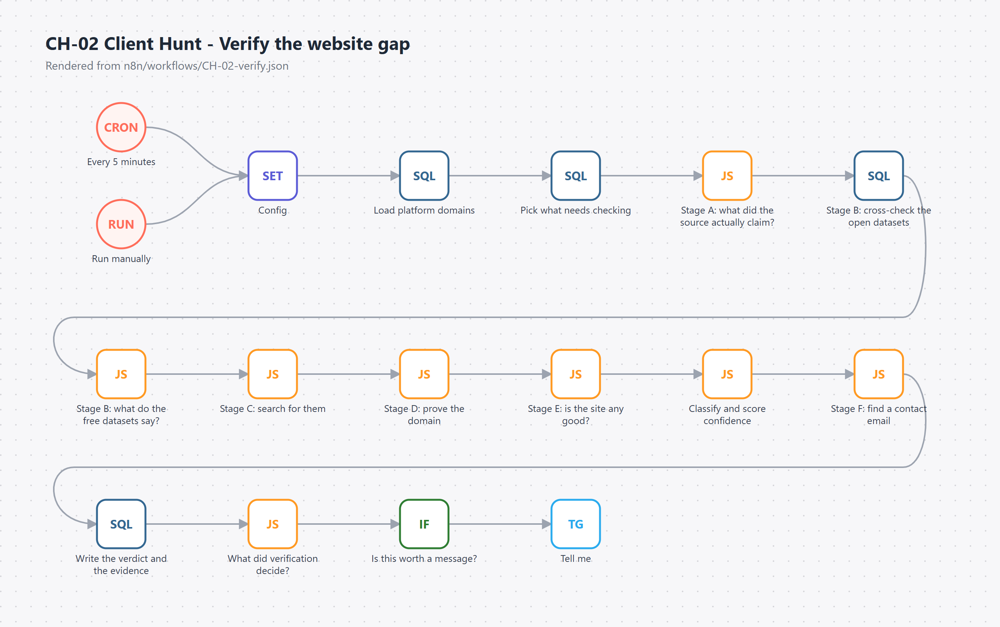
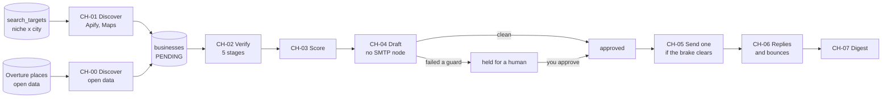

# n8n Client Hunt

Finds small businesses that are trading but have no website, proves they really have none, scores them, and drafts a careful first message. Built on n8n and Postgres.



## What it does

You tell it a niche and a city, like `Beauty Salons + Oslo`. It:

1. **Finds businesses** whose Google Maps listing has no website (through Apify), plus leads from free open datasets.
2. **Proves the gap.** A missing website field on Maps is not evidence of no website; plenty of owners just never filled it in. Five checks run, cheapest first, before anything is called `NO_WEBSITE_CONFIRMED`.
3. **Scores each lead** from 0 to 100. Plain code, no API calls, so it's free to rerun.
4. **Drafts an outreach email** from templates stored in the database, and holds anything that fails a guard for a human.
5. **Sends one approved message at a time**, under a daily cap, a warm-up, business hours in the recipient's country, and a bounce brake.
6. **Tracks replies and bounces** over IMAP, cancels follow-ups for anyone who answered, and pings me on Telegram.

The niche and the city are rows in a table. Switching `Beauty Salons + Oslo` to `Dental Clinics + Dubai` is one `INSERT`. No workflow gets edited.

The rule the whole design follows: **"we checked and found nothing" and "we couldn't check" must never give the same answer.** Mailing a business "I noticed you don't have a website" when they do is worse than not mailing them.

## How it works



CH-02 is where the work is:

| Stage | Check | Cost | What it catches |
|---|---|---|---|
| A | What did the listing actually claim? | free | Instagram-only, Linktree, a dead `business.site` page |
| B | Cross-check Overture and Foursquare open data | free | They have a site, they just never added it to Maps |
| C | Search for them | about $0.001 | A site under a name nobody would guess |
| D | Prove the dataset's site, then guess and prove a domain | free | A "match" that is really the neighbour sharing their phone number |
| E | PageSpeed | free | A site that exists but is unusable |
| F | Find a contact email | free | Only for leads that have some site to look on |

Each stage that completes adds confidence; a stage that couldn't run leaves it lower. A timeout is `unreachable`, never "no website".

| Workflow | What it does | Canvas |
|---|---|---|
| CH-00 | Leads from open data, free | [image](docs/images/CH-00-discover-open-data.png) |
| CH-01 | Leads from Apify's Maps scraper, behind a spend brake | [image](docs/images/CH-01-discover.png) |
| CH-02 | Proves the website gap | [image](docs/images/CH-02-verify.png) |
| CH-03 | Scores leads | [image](docs/images/CH-03-score-leads.png) |
| CH-04 | Drafts and guards outreach | [image](docs/images/CH-04-prepare-outreach.png) |
| CH-05 | Sends one approved message per run | [image](docs/images/CH-05-send-approved.png) |
| CH-06 | Tracks replies and bounces | [image](docs/images/CH-06-track-replies.png) |
| CH-07 | Twice-daily digest | [image](docs/images/CH-07-daily-digest.png) |
| CH-08 | Answers `/stats` and `/concept` on Telegram | [image](docs/images/CH-08-telegram-stats.png) |

The canvases are rendered straight from the workflow JSON in `n8n/workflows/`.

## Features

- **Config is data.** Niches, cities, email templates, scoring weights and consent rules all live in Postgres tables.
- **Open data first.** Overture Maps and Foursquare OS Places are loaded into Postgres once and queried for free. A paid check is the one somebody eventually switches off to save money.
- **A spend brake before the first request.** Apify's free plan blocks runs at $0 rather than warning, so CH-01 checks the remaining credit before it starts.
- **Every guard is checked twice.** CH-04 holds drafts with no email, an address that doesn't carry the business's name, an unfilled placeholder, or a business name that reads as a person's name in a country that needs prior consent. CH-05 checks all of it again at send time.
- **WhatsApp stays human.** For leads with only a phone number, the digest lists tap-to-send links with the message written. A person sends them from their own phone.
- **Snippets, not canvas code.** The JavaScript and SQL live in `n8n/snippets/` and `n8n/sql/`. A build step injects them into the workflow JSON, and the tests read the code back out of the built JSON, so they test what actually runs.
- **Imports never activate anything.** Turning a workflow on spends money, so it's a decision, not a side effect of a deploy.

## Tech stack

| | |
|---|---|
| Orchestration | n8n (self-hosted) |
| Database | PostgreSQL 16 (or Supabase), plain SQL migrations |
| Discovery | Apify Google Maps extractor, Overture Maps, Foursquare OS Places |
| Checks | Serper search (optional), Google PageSpeed, Reoon mailbox verification |
| Messaging | SMTP and IMAP, Telegram bot |
| Code | JavaScript (n8n Code nodes), Python (loaders and tools), Node test runner |
| CI | GitHub Actions: tests, build check, every migration applied twice |

## Run it

You need an n8n instance and a Postgres database.

```bash
git clone https://github.com/shakaibarsalan/n8n-client-hunt.git
cd n8n-client-hunt

node tests/run-all.js                 # every check; needs no services

cp .env.example .env                  # DATABASE_URL, N8N_URL, N8N_API_KEY
set -a && . ./.env && set +a
for f in db/*.sql; do psql "$DATABASE_URL" -v ON_ERROR_STOP=1 -q -f "$f"; done

node tools/build-workflows.js         # snippets + sql -> n8n/workflows/*.json
python tools/import-workflows.py      # dry run: shows what would change
python tools/import-workflows.py --apply    # imports CH-*, all inactive
```

Then in n8n:

1. Create the credentials the workflows name: Postgres, Apify (HTTP header auth), Telegram, SMTP and IMAP.
2. Fill in each workflow's **Config** node: your Telegram chat id, sender name, caps.
3. Add a target, then turn on CH-01 and CH-02 when you're ready to spend:

```sql
INSERT INTO search_targets (niche, niche_query, country, country_code, city, cctlds, enabled)
VALUES ('Dental Clinics', 'dental clinic', 'United Arab Emirates', 'ae', 'Dubai',
        ARRAY['.ae', '.com'], true);
```

To self-host the database next to n8n, `deploy/docker-compose.yml` runs Postgres on `127.0.0.1` and joins your n8n's Docker network. To load open data for a new city, add its bounding box to `tools/load_reference_data.py` and run it with `--dry-run` first: it reports how many websites the datasets hold there, which tells you whether Stage B will help.

## Configuration

| Where | What |
|---|---|
| `.env` | `DATABASE_URL`, `N8N_URL`, `N8N_API_KEY` for the tools; `POSTGRES_PASSWORD` and the mailbox settings for `deploy/docker-compose.yml` |
| n8n credentials | Postgres, `Apify token`, Telegram, SMTP, IMAP |
| CH-02 Config node | `serper_api_key` (optional; without it confidence caps lower), `pagespeed_api_key` (optional) |
| CH-05 Config node | daily cap, warm-up start and step, sending hours, minimum gap, `reoon_api_key` |
| `search_targets` | what to look for, and where |
| `outreach_templates` | the email text, editable with SQL |
| `consent_required_countries` | where a natural person can't be emailed without prior consent |

## Safety and limits

- **This sends cold email.** Read your country's rules and the recipient's before switching CH-05 on. A country missing from `consent_required_countries` is treated as unverified and held, not as clear.
- **Sending is slow on purpose:** one message per run, a daily cap with a warm-up for a new domain, business hours and weekends in the recipient's country, and a bounce circuit breaker. A bounced or opted-out address goes on a suppression list that existed before any outreach code did.
- **Set up SPF, DKIM and MX** for your sending domain first, or most mail will be rejected or spam-boxed.
- **Scraped data stays in your database.** Lead data is personal data about real businesses. Nothing in this repo contains any; the fixtures and examples are invented.
- **Apify scrapes Google Maps on your behalf.** Check that your use fits their terms and Google's.
- **Measured, not assumed:** on the first 30-lead sample, precision for `NO_WEBSITE_CONFIRMED` was 4 of 4, and 14 of 15 across the wider hand-labelled sample. That's a small sample. [docs/POC-RESULTS.md](docs/POC-RESULTS.md) has the numbers and [docs/RESEARCH.md](docs/RESEARCH.md) has the data-source comparison and costs.

More hard-won n8n lessons are in [docs/N8N-GOTCHAS.md](docs/N8N-GOTCHAS.md).

## License

MIT. See [LICENSE](LICENSE).

## Author

Shakaib Arsalan · [shakaib.vercel.app](https://shakaib.vercel.app) · [LinkedIn](https://www.linkedin.com/in/shakaib-arsalan)
